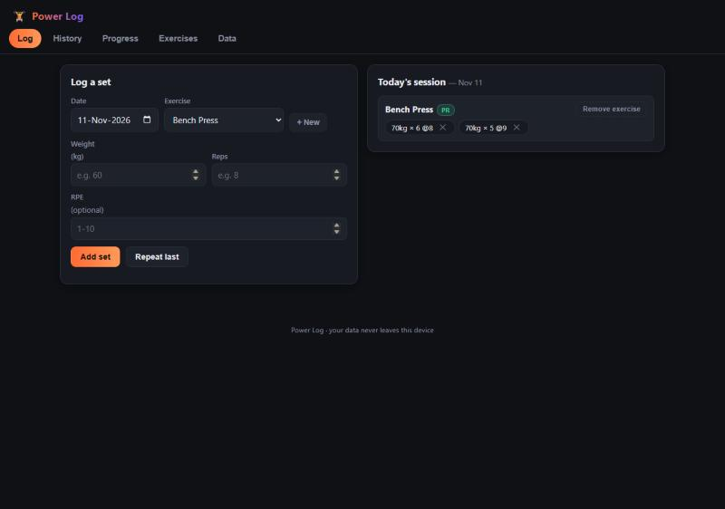
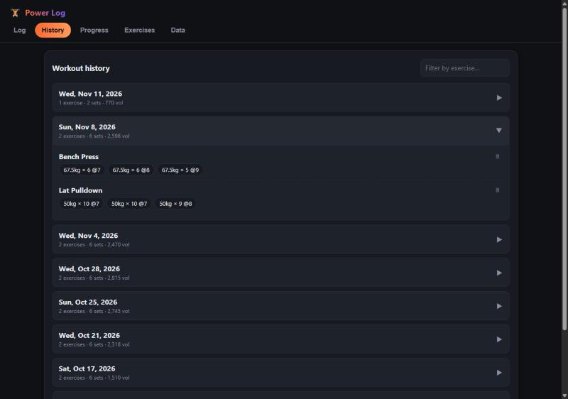
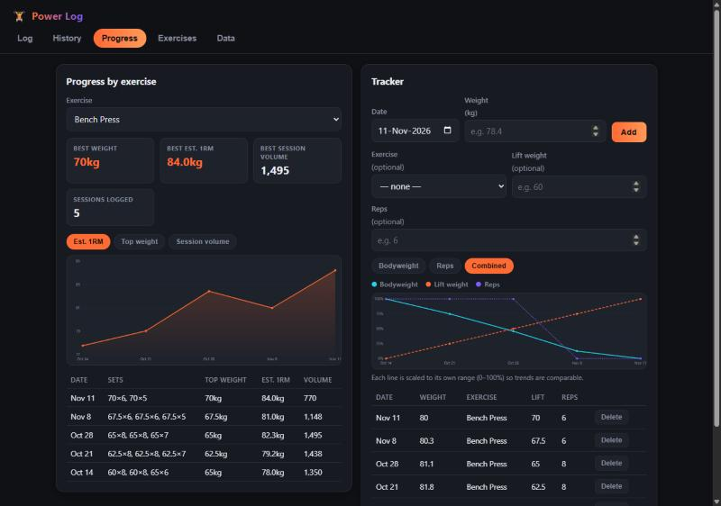
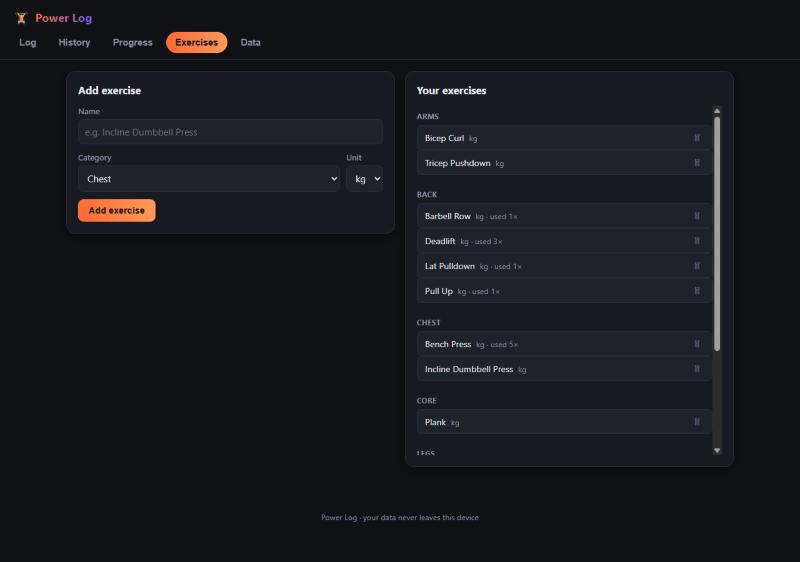
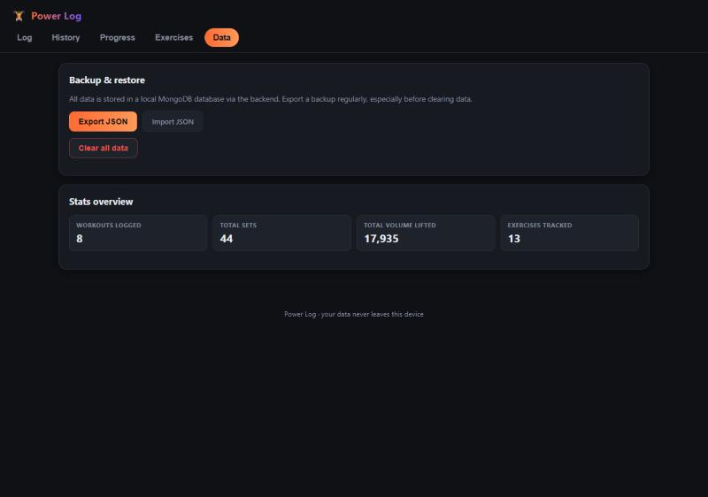

# Power Log — Gym Progress Tracker

A gym progress tracker: a React + TypeScript + Vite frontend backed by a
Node/Express/MongoDB API.

## Features

- **Log** — pick a date and exercise, add sets (weight × reps, optional RPE),
  save them into that day's session. Automatic PR detection.
- **History** — browse past workouts by day, expand to see every set, delete
  entries, filter by exercise name.
- **Progress** — per-exercise chart (estimated 1RM, top weight, or session
  volume) with a stats summary and a full log table. Plus a bodyweight
  tracker that can also log a benchmark lift (exercise + weight + reps) per
  entry, with Bodyweight / Reps / Combined chart views.
- **Exercises** — manage your exercise list (name, category, unit), seeded
  with a sensible default set covering all major muscle groups.
- **Data** — export/import a full JSON backup, or clear everything and start
  fresh.

All data lives in a local MongoDB database via the `server/` API — nothing
leaves your machine. Export a backup (Data tab) if you want a portable copy.

## Screenshots

_Shown with example data for illustration._

| Log | History |
| --- | --- |
|  |  |

| Progress | Tracker (combined view) |
| --- | --- |
|  |  |

| Exercises | Data |
| --- | --- |
|  |  |

## Running it

You need MongoDB running locally (default `mongodb://127.0.0.1:27017`) and
two dev servers: the API and the frontend.

```bash
# 1. Backend (from server/)
cd server
npm install
npm run dev        # http://localhost:4000

# 2. Frontend (from the repo root, in another terminal)
npm install
npm run dev         # http://localhost:8934
```

Then open `http://localhost:8934`. The frontend talks to the API at
`http://localhost:4000/api` by default — override with a `VITE_API_URL` env
var if your backend runs elsewhere.

### Build for production

```bash
# frontend
npm run build        # outputs static files to dist/
npm run preview

# backend
cd server
npm run build        # compiles to server/dist/
npm start
```

## Testing

```bash
# frontend (Vitest + Testing Library) — DataContext business logic
npm test

# backend (Vitest + Supertest + mongodb-memory-server) — API behavior,
# validation, and concurrency
cd server
npm test
```

## Project structure

```
src/                  frontend (React + TS)
  lib/                data types, default exercises, date/math helpers, API client
  store/              React context providers (app data + toasts), backend sync
  components/         one component per tab, plus the line chart and exercise select
  App.tsx             tab navigation and layout
  main.tsx            React entry point

server/               backend (Express + TS + MongoDB)
  src/
    index.ts          entry point: DB connection + server start
    app.ts            Express app wiring (importable by tests without starting a server)
    db.ts             MongoDB connection (Mongoose)
    lib/store.ts       atomic get-or-create + compare-and-swap mutation helper
    lib/validateBody.ts zod request-validation middleware
    validation.ts      zod schemas for each endpoint's input
    models/AppData.ts schema + TS types for the single app-data document
    routes/           data.ts (bulk GET/PUT), exercises.ts, workouts.ts, bodyweight.ts
  tests/              Vitest + Supertest API tests, incl. concurrency stress tests
```

The backend stores everything as one document (exercises, workouts,
bodyweight) — no accounts, single user, matching how the app has always
worked. `GET /api/data` seeds the default exercise list on first run.
Routine edits (adding a set, a bodyweight entry, an exercise, deletes) go
through small per-resource endpoints that apply an atomic compare-and-swap
against the document, so concurrent writers can't silently overwrite each
other's changes. `PUT /api/data` still exists for whole-dataset replace
operations (JSON import, "clear all data").

## Estimated 1RM

Progress charts use the Epley formula: `1RM ≈ weight × (1 + reps / 30)`.

